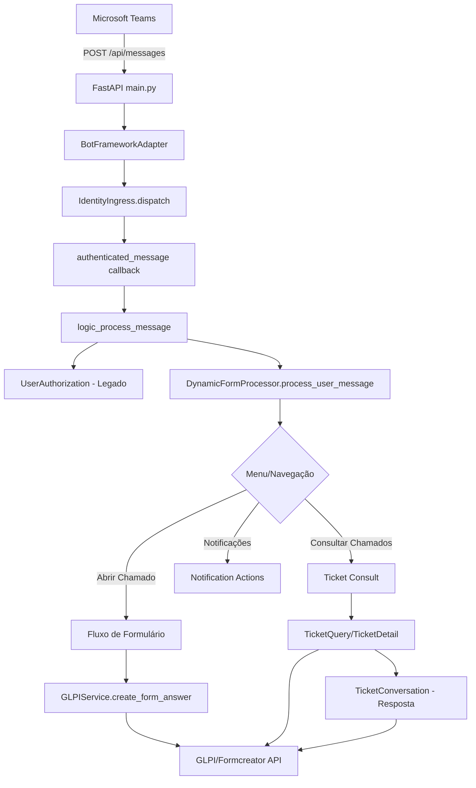

# Arquitetura - Fluxo Geral

## Visão Geral da Arquitetura

## Componentes Principais

### 1. Camada de Entrada (main.py)
- **FastAPI app**: Expõe endpoints HTTP
- **BotFrameworkAdapter**: Gerencia autenticação com Bot Framework
- **IdentityIngress**: Intercepta atividades para resolução de identidade antes do processamento
- **on_turn_error**: Tratamento global de erros com proteção para fluxos sensíveis

### 2. Camada de Identidade (identity/)
- **identity/ingress.py**: Entrada para resolução autenticada de identidade Teams-GLPI
- **identity/service.py**: Resolve identidade validando tenant, remetente e vínculo GLPI
- **identity/store.py**: Armazena vínculos SQLite (migrações v1→v2→v3→v4)
- **identity/glpi.py**: Leitura exata de usuários GLPI
- **identity/email_lookup.py**: Busca automática por e-mail (opt-in)
- **identity/notifications.py**: Referências para notificações

### 3. Camada de Bot (bot/)
- **bot/dialogs.py**: Processador dinâmico de formulários, navegação, menu
- **bot/state.py**: ConversationState, UserState, NavState, TicketQueryState, etc.
- **bot/cards.py**: Geração de HeroCards para Teams
- **bot/auth.py**: Autorização legada por domínio/grupos
- **bot/glpi_auth.py**: Consultas de usuários/e-mails/grupos no GLPI
- **bot/ticket_consult.py**: Consulta de chamados próprios
- **bot/ticket_detail.py**: Detalhes, histórico público, resposta
- **bot/attachments.py**: Download/análise de anexos do Teams
- **bot/notification_actions.py**: Tratamento de cliques em notificações

### 4. Camada de Serviços (services/)
- **services/glpi_service.py**: Criação de tickets via Formcreator, vinculação de documentos
- **services/ticket_query.py**: Consulta filtrada por requerente
- **services/ticket_conversation.py**: Histórico público (ITILFollowup) e envio de respostas
- **services/ticket_content.py**: Sanitização e formatação de conteúdo HTML
- **services/reply_sender.py**: Envio atômico de respostas com controle de retry

### 5. Camada de Notificações (notifications/)
- **notifications/worker.py**: Worker dedicado para envio de notificações
- **notifications/policy.py**: Política de autores (por grupos GLPI)
- **notifications/glpi.py**: Consultas para detecção de novos followups
- **notifications/queue.py**: Fila de notificações

## Fluxo de Processamento

1. **Recebimento**: Teams envia atividade para `/api/messages`
2. **Autenticação**: Bot Framework Adapter valida
3. **Resolução de Identidade**: IdentityIngress tenta resolver identidade se habilitada
4. **Autorização Legada**: Para abertura de chamado, valida domínio conforme configuração
5. **Processamento**: DynamicFormProcessor roteia para menu/formulário/consulta/notificações
6. **Interação**: Responde com HeroCards ou texto simples
7. **Persistência de Estado**: Salva ConversationState/UserState no MemoryStorage
