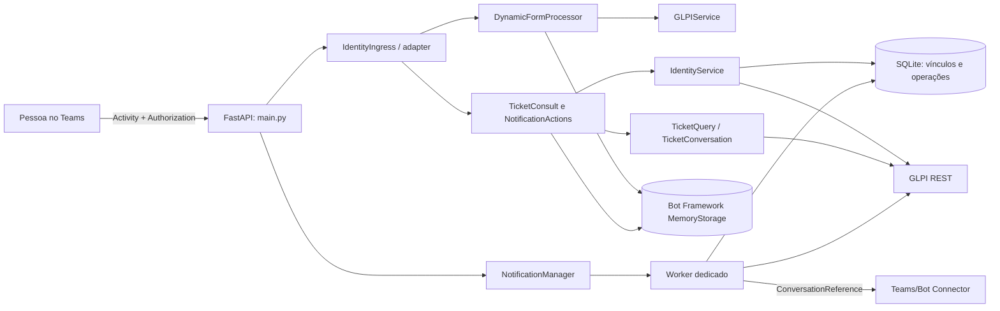

# Visão de arquitetura

[[obsidian/01 - Arquitetura/Indice|← Arquitetura]] · [[obsidian/Inicio|Início]]

## Sistema e fronteiras

O Otto é um bot Python para Microsoft Teams. A API FastAPI recebe atividades do Bot Framework. Uma única passagem pelo adapter autentica e encaminha a atividade; a lógica decide se usa apenas o fluxo de abertura legado ou se solicita resolução autenticada para uma operação de consulta/notificação. O GLPI é chamado por HTTP via `requests`.

O diagrama representa dependências vistas no código, não um diagrama de implantação validado. A opção padrão de notificações é desabilitada.

## Camadas

1. **Entrada web:** [main.py](../../../main.py#L194) expõe `POST /api/messages`, passa o cabeçalho `Authorization` para [IdentityIngress.dispatch](../../../identity/ingress.py#L21) e processa a Activity dentro do callback.
2. **Orquestração do bot:** [DynamicFormProcessor](../../../bot/dialogs.py#L51) prioriza ação de notificação, consulta sem formulário ativo e, então, o formulário/navegação.
3. **Domínios separados:** `bot/` apresenta fluxo Teams; `identity/` resolve vínculo; `services/` contém acesso ao GLPI; `notifications/` executa observação e entrega.
4. **Persistência:** `UserState`/`ConversationState` usam `MemoryStorage`; vínculo, auditoria, resposta e fila de notificações ficam em SQLite.
5. **Serviço auxiliar:** as operações HTTP síncronas de `requests` em fluxos assíncronos são isoladas com `asyncio.to_thread` em vários caminhos sensíveis. Isso não transforma toda chamada da aplicação em I/O assíncrono.

## Entrada HTTP

- `POST /api/messages`: exige `application/json`, desserializa Activity e a entrega uma vez ao adapter. O endpoint retorna 200 se o adapter não fornecer resposta, e também responde 200 no `except` externo; atividades sem tipo `message` são ignoradas pela lógica.
- `GET /health`: resposta de saúde da aplicação, não verifica autenticação, GLPI nem entrega do Teams.
- `GET /api/status`: informa versões fixas de apresentação, formulários carregados e indicadores superficiais de configuração; não é teste de integração.
- Execução direta chama Uvicorn em `0.0.0.0:3000`, conforme [main.py](../../../main.py#L245).

## Decisões observadas e limites

- Uma instância e disco local persistente são pressupostos explícitos. MemoryStorage não compartilha estado entre réplicas; SQLite/locks locais não formam coordenação distribuída.
- O manager de notificação tem thread/event loop próprio e lock por banco, separado do loop que atende as atividades (ver [NotificationManager](../../../notifications/manager.py#L11)).
- A abertura do chamado usa autorização legada; consulta/resposta usam uma identidade do Teams validada e associação GLPI diferente. Não inferir que a abertura legada herda o vínculo seguro.
- Falhas após criar FormAnswer podem deixar operações subsequentes parcialmente concluídas; o fluxo não é transação distribuída.
- O repositório não estabelece a configuração do serviço em produção, identidade real dos usuários, versão implantada do GLPI ou aceitação visual dos cartões.

## Navegação

[[obsidian/02 - Modulos/Indice|Módulos]] · [[obsidian/03 - Fluxos/Indice|Fluxos]] · [[obsidian/04 - Dados/Indice|Dados]] · [[obsidian/05 - Interfaces e Integracoes/Indice|Interfaces]] · [[obsidian/08 - Pendencias/Indice|Pendências]]
