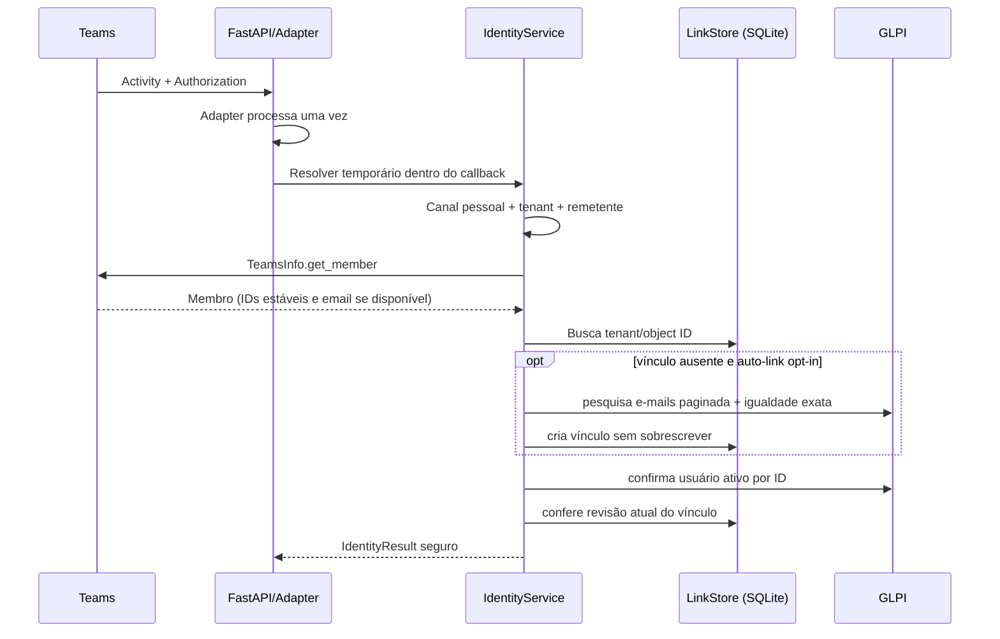

# Identidade e autorização

[[obsidian/03 - Fluxos/Indice|← Fluxos]] · [[obsidian/Inicio|Início]]

## Consulta/resposta: caminho autenticado

O e-mail só é considerado pelo modo automático opt-in e vem do membro autenticado consultado por TeamsInfo. Não se usa nome, UPN, mensagem, botão ou e-mail informado pelo usuário como fallback. Autenticação de Activity/tenant depende do adapter e da configuração real; a existência dessa implementação não valida credenciais ou tenant do deployment.

## Abertura: autorização legada distinta

`main.logic_process_message` consulta a decisão `needs_legacy_authorization`. O fluxo de abertura usa `UserAuthorization`, que procura o e-mail pelo nome de exibição no GLPI e confere domínio permitido; formulário de cadastro também usa lista de e-mails/grupos e busca legada. A comparação de nome/grupo tem limitações que impedem tratar isso como prova de identidade moderna. O caminho de abertura permanece independente do vínculo SQLite.

## Revalidação de recursos

A cada operação, a identidade e usuário GLPI são revistos. Para cada Ticket, o serviço checa `is_deleted`, status e relação explícita `Ticket_User` com `type=1` (requerente). ID, número e botões só selecionam recursos; não concedem permissão. Itens de histórico também são condicionados ao pai Ticket e `is_private=0`.

[[obsidian/02 - Modulos/Identidade|Componentes]] · [[obsidian/04 - Dados/Persistência e modelos|Tabelas e estado]] · [[obsidian/08 - Pendencias/Homologação|Provas pendentes]]
