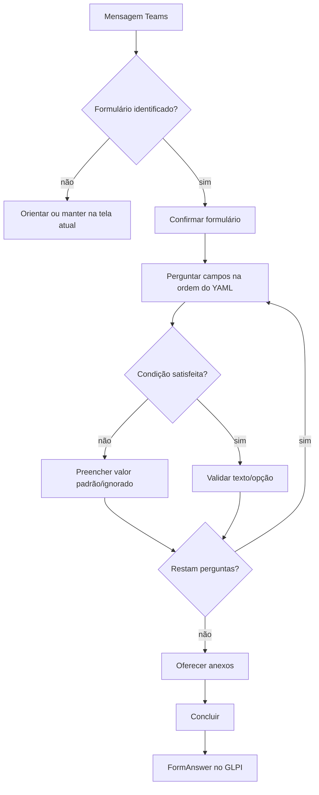

# Menu e abertura de chamados

[[obsidian/03 - Fluxos/Indice|← Fluxos]] · [[obsidian/Inicio|Início]]

## Menu

Em conversa pessoal Teams, o menu anuncia `1 — Abrir chamado`, `2 — Consultar chamados`, `3 — Sair`. Botões `messageBack` e entrada numérica levam às mesmas ações. “Sair” encerra navegação, não altera vínculo ou persistência. Em canal/grupo, o tratamento permanece textual.

Quando existe formulário ativo, menu/sair não descartam o trabalho de imediato: é exibida confirmação ligada a token aleatório; o usuário pode continuar ou cancelar. Número usado como resposta normal não é interpretado como ação de menu quando a pergunta está em curso.

## Reconhecimento e formulário

`DynamicFormProcessor.identify_form` percorre as palavras-chave de `config/forms.yaml`. A escolha é confirmada antes das perguntas. O processador constrói perguntas na ordem declarada; as regras `depends_on` podem pular campos, e a resposta é validada por número ou texto da opção.

## Anexos e confirmação final

Depois das perguntas, o bot pergunta se haverá anexos. Arquivos podem ser enviados na etapa dedicada, confirmados e mantidos temporariamente em base64 no estado. A classificação de HTML técnico da Activity evita considerar a representação HTML de texto como arquivo. Arquivo real em etapa de pergunta é recusado; arquivos enviados para a etapa de anexo são baixados e, depois da criação, carregados como documentos e vinculados ao Ticket.

O `FormCreationResult` separa ID de FormAnswer e ID real do Ticket associado. Se o FormAnswer é criado mas não se encontra o Ticket, a mensagem não inventa número e o sistema não cria novamente. Vínculo de requerente, remoção de ator do bot, documentos e acompanhamento de origem podem falhar após a abertura; o sucesso da criação não é prova de que cada ação posterior concluiu.

## Formulários e autorização

IDs, campos, opções, ordem e condições estão em [[obsidian/04 - Dados/Formulários|Formulários GLPI]]. O cadastro de novo colaborador tem verificação legada de acesso. Não foi verificada a autorização efetiva em produção.

Arquivos: [bot/dialogs.py](../../../bot/dialogs.py#L51), [bot/cards.py](../../../bot/cards.py#L202), [services/glpi_service.py](../../../services/glpi_service.py#L450).
