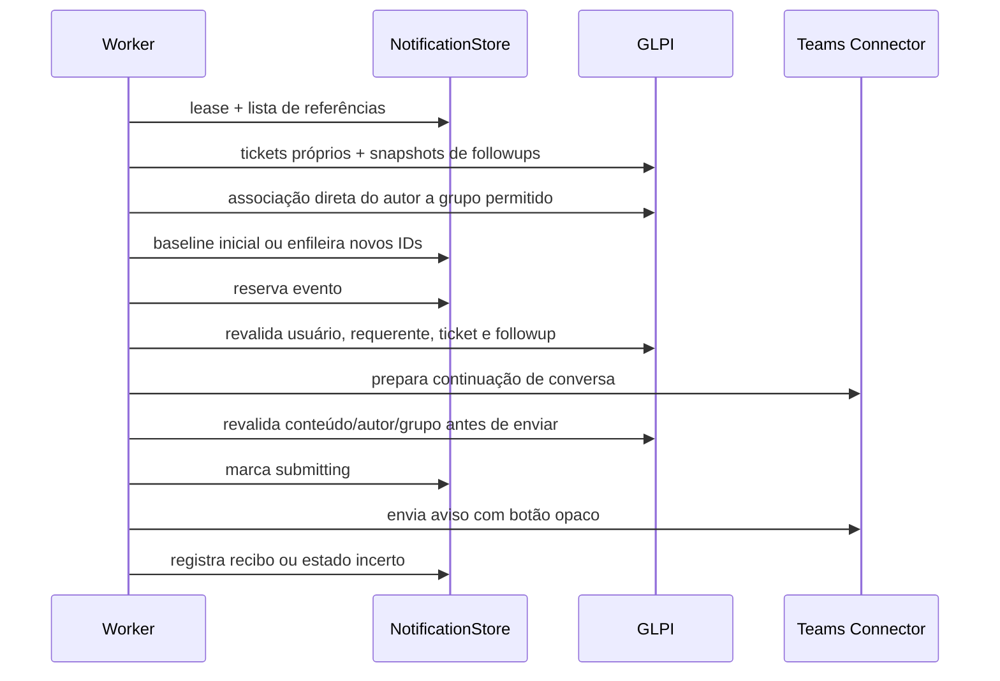

# Notificações públicas do suporte

[[obsidian/03 - Fluxos/Indice|← Fluxos]] · [[obsidian/Inicio|Início]] · [[obsidian/07 - Operacao/Execução e notificações|Operação]]

## Ativação e captura

Notificações são desabilitadas por padrão. Com política configurada, uma atividade pessoal autenticada que resolveu identidade pode salvar uma ConversationReference reduzida. Uma abertura simples não força resolução de identidade. Falha de captura não deve impedir a abertura.

## Ciclo do worker

Somente acompanhamento público (`is_private=0`) cujo autor pertença diretamente a grupo configurado, excluindo usuário destinatário, usuário de integração e recibos de respostas do próprio bot, é elegível. Grupo classifica o autor; não concede acesso ao Ticket.

## Baseline, deduplicação e incerteza

O primeiro snapshot completo por geração/ticket grava o maior ID sem notificar o histórico. Coleções incompletas não avançam marco. A fila não armazena texto do acompanhamento. Notificação é validada novamente ao clicar; tokens não aceitam ticket arbitrário.

Lease evita dois workers no mesmo SQLite. Antes do possível envio, estado passa para `submitting`; queda depois desse fence fica `uncertain`, sem repetição automática. Não existe garantia exactly-once nem snapshot transacional entre GLPI e Teams. Ver [[obsidian/04 - Dados/Persistência e modelos|Modelo SQLite]] e [[obsidian/08 - Pendencias/Homologação|Homologação]].

## Interação com trabalho em andamento

O handler consome o payload de notificação antes de formulário e captura textual. Se há formulário, oferece continuar ou cancelar de forma explícita; o payload não descarta respostas/anexos por si só. Se há resposta em elaboração, oferece continuar ou guardar e abrir o aviso; o rascunho preservado mantém o prazo original. Notificação não substitui nem altera `UserProfile`/estado da resposta ao enviar proativamente. Botões antigos, copiados ou expirados são recusados por token, binding e versão.

Limites implementados do ciclo e transporte: [[obsidian/02 - Modulos/Notificações|Módulo de notificações]].
